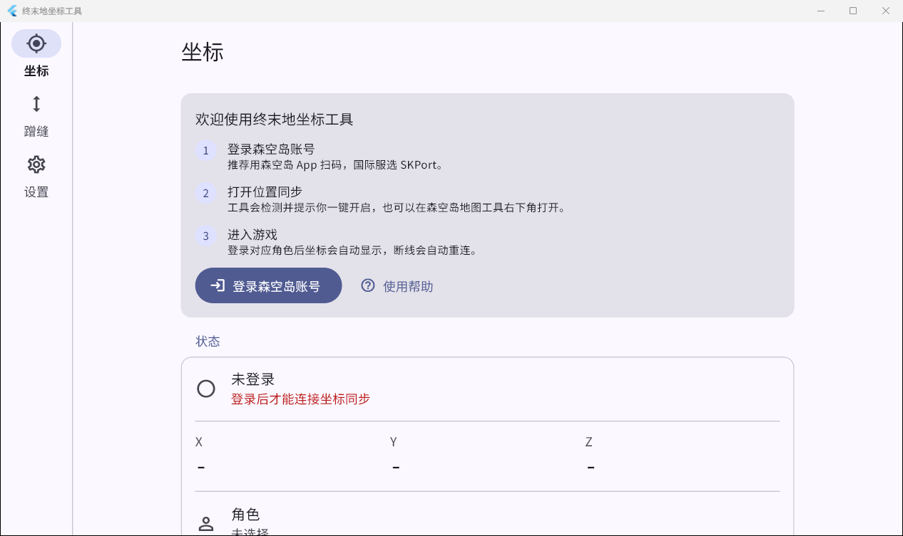
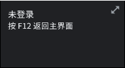

<div align="center">

# Zipliner Client

**终末地滑索规划网站 Zipliner 的辅助工具，包含实时显示《明日方舟：终末地》角色坐标、辅助采集滑索数据等功能的跨平台小工具**

[](https://github.com/ZipField/zipliner-client/releases/latest)
[](https://github.com/ZipField/zipliner-client/actions/workflows/ci.yml)
[](LICENSE)

Windows · Android · Linux

</div>



## 它能做什么

- **实时坐标**：使用 Zipliner 绑定账号或本机森空岛 / SKPort 账号直连，实时显示角色的 X / Y / Z 坐标和所在地图。
- **独立坐标小窗**（Windows / Linux）：主界面始终保留，坐标在独立的小窗显示，默认 `F12` 切换显示/隐藏；Linux 的该快捷键仅在主界面获得焦点时生效。
- **跟随游戏窗口**（Windows）：坐标窗贴在游戏窗口指定位置，背景透明、鼠标穿透，不挡操作。
- **滑索采集**：站在滑索上自动识别，或一键获取脚下滑索的坐标与朝向，复制为 Zipliner 可导入的 JSON，可选记录 CSV。
- **多账号**：可以添加多个森空岛 / SKPort 账号，在角色之间切换。
- **自动弱网**（Windows）：根据网络流量与坐标辅助识别，支持暂时解除弱网、自定义快捷键和 10–30 秒最大时长，默认 20 秒。功能默认关闭，需要先连接坐标；每次启动后首次启用须确认风险并允许管理员权限，首次使用另有 5 秒确认倒计时。常规游戏期间请关闭此功能。



## 下载安装

到 [Releases 页面](https://github.com/ZipField/zipliner-client/releases/latest) 下载对应文件：

| 设备 | 下载 | 使用 |
| --- | --- | --- |
| **Windows 电脑** | `…-windows-x64.zip` | 右键 → 全部解压缩 → 打开文件夹 → 双击 `zipliner_client.exe` |
| **安卓手机 / 平板** | `…-android.apk` | 下载后点开安装，提示“未知来源”时选择允许 |
| Linux | `…-linux-x64.tar.gz` | 解压后运行 `zipliner_client`（需要 GTK3 与 libsecret） |

> [!TIP]
> - 一定要先**解压**再运行，不要在压缩包里直接双击。
> - Windows 提示“Windows 已保护你的电脑”：点 **更多信息** → **仍要运行**。本工具是开源软件，没有购买代码签名证书。
> - **升级**：下载新版本解压覆盖旧文件即可，账号和设置都会保留。新版本发布后，工具启动时会自动提示。

## 三步上手

1. **选择账号模式**：首页登录 Zipliner，可管理网站上的绑定账号并共享实时定位；也可选择本地模式，在本机登录森空岛 / SKPort。旧版本机账号和角色选择会自动迁入本地游客档案，无需重新添加。
2. **打开位置同步**：工具检测到角色没有打开森空岛的“位置同步”时会提示，点 **同意并连接** 即可；
   也可以在森空岛 App → 终末地 → 地图工具的右下角手动打开。
3. **进入游戏**：登录对应角色后坐标会自动出现。断线、网络波动、角色暂时不在线时都会**自动重连**，不需要手动操作。

应用里的 **设置 → 使用帮助** 有完整的常见问题解答。

## 常见问题

<details>
<summary><b>一直显示“没有收到坐标”？</b></summary>

确认已经进入游戏，并且登录的就是“角色”一栏里的那个角色；再到森空岛 App 的地图工具确认能看到自己的位置。
有多个角色时，点“角色”切换。工具会每隔一会儿自动重试。
</details>

<details>
<summary><b>提示“登录已失效”？</b></summary>

森空岛的登录会过期，修改密码后也会失效。点状态栏里的 **重新登录**，或打开“账号管理”，在对应账号上点 **重新登录**。
</details>

<details>
<summary><b>坐标小窗怎么回到主界面？</b></summary>

按快捷键（默认 `F12`，可在“坐标显示”里修改），或点小窗右上角的按钮。
开启“跟随游戏窗口”后小窗鼠标穿透，只能用快捷键返回；如果没有找到游戏窗口，小窗会保持可点击。
如果按了快捷键没反应，可以换一个不常用的键，或尝试右键“以管理员身份运行”本工具。
</details>

<details>
<summary><b>打不开、闪退或者有其他问题？</b></summary>

打开 **设置 → 复制诊断信息**，然后到 [Issues](https://github.com/ZipField/zipliner-client/issues) 提交问题并粘贴。
诊断信息只包含版本、系统、连接状态和日志，不包含账号凭据。
</details>

## 安全与隐私

- **账号模式与存储**：Zipliner 模式的绑定由 Zipliner 后端管理，客户端直连获取坐标，网站开启实时位置后才上传转发；直连凭据保存在系统安全存储。账号管理顶部的全宽按钮可切换查看网站绑定和本机账号；登录 Zipliner 时也能直接选用本机角色，无需退出或重复添加账号。
- **区域信息与更新**：地图名称和高度范围从 Zipliner 后端获取；版本更新向 GitHub 查询。这些请求不向其发送森空岛账号凭据或游戏网络流量。
- **本机凭据**：本地模式的账号凭据用系统加密保存（Windows DPAPI、Android Keystore、Linux 密钥环），不会自动上传。选择绑定到 Zipliner 时，相关账号绑定和定位由 Zipliner 服务管理。
- **坐标悬浮窗**：“跟随游戏窗口”只读取所选游戏程序的窗口位置和前台状态，默认 `Endfield.exe`；不读写游戏内存、不注入、不向游戏发送输入。切换目标窗口也会切换弱网目标程序。
  全局快捷键通过定时读取按键状态实现，不安装键盘钩子。
- **弱网功能**：手动开启后，Windows 网络辅助程序需要处理目标游戏的网络连接，需要读取上传下载包并对网络做出限制，不对发包进行任何修改。 [弱网说明](docs/weak-network.md)。
- **开源可审计**：全部源码以 GPL-3.0 协议公开。

## 开发

需要 Flutter 3.47（Dart 3.13）。Linux 构建额外需要 `libgtk-3-dev libsecret-1-dev libjsoncpp-dev`。

```sh
flutter pub get
flutter test
flutter run -d windows
# 调试时把窗口放到副屏（逻辑像素 x,y,w,h，仅 Windows runner 读取）
ZIPLINER_WINDOW="-1880,300,1280,760" flutter run -d windows
```

```
lib/
  main.dart       进程入口、单实例和异常处理
  app/            启动、依赖装配、导航和用户设置
  shared/         HTTP、日志、序列化、格式化和公共组件
  integrations/   森空岛 / SKPort 协议实现
  platform/       桌面系统集成
  features/       账号、定位、采集、悬浮窗、弱网、地图、设置
```

具体职责、依赖边界与测试约定见[目录与维护说明](docs/architecture.md)。

实现要点：

- **签名**：`md5(hex(hmacSha256(token, path + query/body + timestamp + headerJson)))`，时间戳比当前早 3 秒，并用 zonai 的 `Date` 头校正本机时钟。
- **全局快捷键**：`hotkey_manager` 在 Windows 上注册热键会让进程退出，改为每 40ms 调用 `GetAsyncKeyState` 读取按键状态（含“按下过”位，能捕捉快速点按）。
- **不调用 `windowManager.setSkipTaskbar`**：在 Windows 上会让进程卡死。
- **多显示器缩放**：window_manager 用 Dart 端的 devicePixelRatio 换算坐标，混合缩放时不可靠，Windows 上直接用 Win32 物理坐标保存 / 恢复窗口和摆放坐标窗。
- **MD3 布局**：宽屏侧栏布局下标题由内容区渲染（避免顶部栏压在侧栏上方）；`TfSection` 中的非列表项用 `SectionBody` 补边距；Windows 显式使用微软雅黑。

## 发布

推送 `vX.Y.Z` 标签即可，[Release 工作流](.github/workflows/release.yml) 会先跑测试，再构建 Windows / Linux / Android 并创建 Release：

```sh
git tag v0.3.0
git push origin v0.3.0
```

- Windows 包附带 VC++ 运行库 DLL 与中文使用说明。
- Android 使用固定签名（仓库 Secrets：`ANDROID_KEYSTORE_BASE64`、`ANDROID_KEYSTORE_PASSWORD`、`ANDROID_KEY_ALIAS`、`ANDROID_KEY_PASSWORD`），
  保证新版本可以直接覆盖安装。**签名文件丢失后将无法再发布可覆盖升级的 APK，请妥善备份。**
- 版本号来自标签：`--build-name` 取标签数字部分，`--build-number` 取工作流运行序号，`APP_VERSION` 用于应用内显示和更新检查。

## 致谢

- 功能移植自 [ZipField/endfield-player-position-display](https://github.com/ZipField/endfield-player-position-display)。
- 界面基于 [tf_framework](https://pub.dev/packages/tf_framework)。
- 森空岛接口的调用方式参考 Zipliner 服务端实现。

本项目与鹰角网络（Hypergryph / Gryphline）无关，“明日方舟：终末地”“森空岛”等为其商标。

## 许可证

[GPL-3.0-or-later](LICENSE) © ZipField 与贡献者
